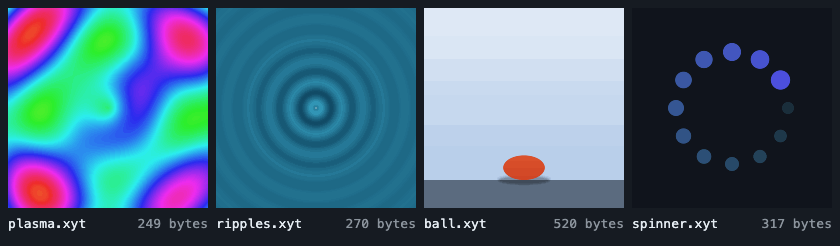

# XYT

**Pictures and motion as formulas of x, y and t.** A few lines of text compile to a GPU shader that paints every pixel, at any resolution. The language is small and forgiving on purpose, so that people *and* language models can write it.



**[Try it in the playground](https://xytmotion.github.io/xyt-motion/playground/)**: a live editor with every example.

```text
duration 2
fill mix(#0b1a33, #2c5aa0, y)
let bounce = abs(sin(p * pi))
circle cx=0.5 cy=0.8 - 0.5 * bounce r=0.08 color=orange
```

That is a complete, looping animation: 120 bytes.

- **Tiny.** The included 30-second, four-scene cartoon is 11 KB of text. Our ten benchmark animations are 136 to 701 bytes each, 29 to 704 times smaller than the same 4 seconds as H.264 video (plus the library, once per page: see [Benchmarks](#benchmarks)), and they stay sharp at any size.
- **Written by people and by AI.** Named values (`cx=0.5`), clear error messages with fix suggestions, forgiving aliases, and math that cannot crash. The language reference for models is about 1,000 tokens. In an informal early test, a model given only that reference wrote all ten benchmark animations, and they compiled and rendered as well as the hand-written ones.
- **Live.** Programs can read the pointer (`mx`, `my`), the beat (`beat`, `pulse`) and inputs your page changes at runtime, which a video file never can.
- **Small library.** 21 KB gzipped, no dependencies, TypeScript types included, WebGL 1, runs on practically every browser and phone. Text is a 5 KB plugin for pages that need it.

Status: early (0.2). The language may still change before 1.0.

## Quick start

### One tag

```html
<script src="https://unpkg.com/xyt-motion/dist/xyt.min.js"></script>

<xyt-player src="hero.xyt"></xyt-player>

<!-- or inline -->
<xyt-player>
  <script type="text/xyt">
    fill mix(navy, black, y)
    circle cx=0.5 cy=0.5 + 0.1 * sin(t * 2) r=0.1 color=gold
  </script>
</xyt-player>
```

The element fills its container's width and takes the program's shape (`canvas 16:9` and so on). Attributes: `src`, `paused`, `once` (play one time), `still` (show a still frame instead of playing). Events: `xyt-load`, `xyt-error`.

### JavaScript

```js
import { Player } from 'xyt-motion';

const player = new Player(document.querySelector('canvas'), { source: programText });
player.set('wind', 0.8);   // change an `input` live
player.seek(3).pause();
```

### Compile only (Node, workers, build tools)

```js
import { compile } from 'xyt-motion';

const result = compile(source);
if (!result.ok) console.log(result.errors); // [{ line: 3, message: "circle has no 'colr'. Did you mean 'color'? ..." }]
else useShader(result.glsl);               // a GLSL ES 1.00 fragment shader
```

### Command line

```sh
npx xyt-motion check film.xyt          # errors, warnings, and which lines the cost comes from
```

Rendering runs the real player in headless Chromium, so it needs Playwright (an optional dependency) and, for video, ffmpeg:

```sh
npm i -D xyt-motion playwright && npx playwright install chromium
npx xyt render film.xyt --at 12.5                  # one frame as PNG
npx xyt render film.xyt --sheet                    # 12 frames across the duration on one PNG
npx xyt render film.xyt --mp4 --audio song.mp3     # H.264 video with a sound track
```

Frames are exactly what a browser shows. Options: `--height`, `--fps`, `--from`/`--to`, `--frames`, `--set name=value` for inputs, `-o` for the output file. A language model writing XYT can use `check` and `--sheet` to read its errors and look at its own frames.

## The language in two minutes

Coordinates run from 0 to 1 down the canvas (`y`, top to bottom) and from 0 to `aspect` across it (`x`, 1 on the default square canvas). `t` is seconds, `p` is loop progress from 0 to 1. **Every value can be a formula.** Lines paint in order, later over earlier.

```text
canvas 16:9                      // x now goes 0 to 1.778
duration 6
fill mix(#1b1f4a, #ffb35c, y)    // a gradient: one line, every pixel
circle cx=aspect / 2 cy=0.4 + 0.2 * p r=0.1 color=mix(white, gold, y * 3)
```

Shapes: `circle ellipse rect line tri ring arc star`, each with `color alpha blur stroke`. Values are named, and common alternatives are accepted (`radius=` works for `r=`).

Reuse and structure:

```text
define bird cx=0.5 cy=0.5 s=1 flap=0          // a character, drawn once...
  ellipse cx=cx cy=cy rx=0.05 * s ry=0.03 * s color=white
  tri x1=cx y1=cy x2=cx - 0.06 * s y2=cy - 0.05 * s * flap x3=cx + 0.02 * s y3=cy color=white
end

scene 0 6 fade=0.5                          // only between 0 and 6 seconds
  repeat i 5                                // a GPU loop
    bird cx=0.2 + i * 0.3 + st * 0.05 cy=0.3 + 0.05 * hash(i) flap=pingpong(st * 3 + i)
  end
end
```

Transforms: `group cx= cy= angle= scale= flip=` turns, scales and mirrors what it holds around a point (a bell around its hanger), `camera` does the same for the rest of a scene, and `clip circle ...` draws its contents only inside a shape. A define call takes `angle`, `scale` and `flip` directly.

Motion helpers: `keys(t, 0, 0.2, 1.5, 0.8, 3, 0.2)` moves smoothly through values at key times (colors work too), `ease easein easeout backout bounce pingpong`, `spring(t - 2)` for a swing that dies out, `hits(t, 1, 2.5)` for a flash at each listed time. Texture: `noise fbm hash`. Rhythm: `bpm 120` then `beat` and `pulse`. Interaction: `mx`, `my`, and `input name = 0.5` for values your page controls.

Shapes include `curve`, a line bent toward a control point. Scenes can be timed in bars (`bpm 96` then `scene bars 9 16`) so a program follows the tempo of the track under it.

Full reference: [docs/language.md](docs/language.md). Fifteen examples: [examples/](examples/).

## Using it with a language model

The library exports the compact reference written for models:

```js
import { reference, compile } from 'xyt-motion';

const prompt = `${reference}\n\nWrite an XYT program for: "${request}".\nReply with only the program, no markdown fences.`;
let program = await askModel(prompt);

const result = compile(program);
if (!result.ok) {
  // Errors name the line and usually the fix; one round of feedback fixes most mistakes.
  const errors = result.errors.map((e) => `line ${e.line}: ${e.message}`).join('\n');
  program = await askModel(`${reference}\n\nFix this XYT program.\n\n${program}\n\nErrors:\n${errors}\n\nReply with only the corrected program.`);
}
```

The same text is in [docs/llm-reference.md](docs/llm-reference.md). When a page loads a plugin, add its reference too: `${reference}\n\n${text.reference}`. Programs are pure drawing: they cannot touch the page, the network or storage, so running model-written XYT is far safer than running model-written HTML or JavaScript. They can still be slow: `compile` rejects programs past a cost limit and warns well before it, so check `warnings` before showing a model's program to other people.

## Plugins: text

Plugins add commands for the pages that want them, and keep the library small for everyone else. The first one draws text: titles, lyrics, karaoke, credits.

```html
<script src="https://unpkg.com/xyt-motion/dist/xyt.min.js"></script>
<script src="https://unpkg.com/xyt-motion/dist/xyt-text.min.js"></script>  <!-- registers itself -->
```

```js
import { use } from 'xyt-motion';
import text from 'xyt-motion/text';
use(text);
```

```text
use text
text "Frère Jacques" x=aspect / 2 y=0.7 size=0.06 color=white
text "Frère Jacques" x=aspect / 2 y=0.7 size=0.06 color=gold reveal=sp   // the karaoke sweep
```

Text is drawn with strokes, like every shape, so it turns, scales, blurs and clips like one. It covers ASCII and accented Latin letters for French, Spanish, Portuguese, German, Serbian and Croatian, Czech and most of Polish. A program can only name a plugin the page loaded (`use text`), never load code. Details: [docs/language.md](docs/language.md#plugins).

## API

### `compile(source)`

Never throws for problems in the source. Returns:

| Field | Meaning |
|---|---|
| `ok` | `true` when there are no errors |
| `errors` | `[{ line, message }]`, sorted by line; several lines can report at once |
| `warnings` | for example a program heavy enough to be slow on phones |
| `glsl` | the fragment shader (GLSL ES 1.00) |
| `duration`, `aspect`, `aspectLabel`, `bpm`, `offset` | from the program's setup lines |
| `inputs` | `[{ name, kind: 'num' or 'col', value, min, max }]` |
| `scenes` | `[{ start, end, fadein, fadeout }]` |
| `defines` | names of reusable drawings |
| `cost` | work per pixel in the busiest moment, in shapes (`noise` and `fbm` count as several); a performance estimate |
| `costs` | `[{ line, cost }]`, heaviest first: which lines the cost comes from, while they are drawn |
| `plugins` | plugins the program uses (`use text`) |

### `new Player(canvas, options)`

| Option | Default | |
|---|---|---|
| `source` | | program to load |
| `autoplay`, `loop` | `true` | |
| `clock` | | external time source in seconds, such as `() => audio.currentTime` |
| `reducedMotion` | `'still'` | viewers who prefer reduced motion see a still frame (`'play'` to animate anyway) |
| `still` | `false` | always show the still frame instead of playing |
| `poster` | 30% of duration | time of the still frame |
| `adaptive` | `true` | lower the resolution when frames are slow |
| `pauseWhenHidden` | `true` | stop drawing while the canvas is off screen |
| `pointer` | `true` | feed the pointer into `mx`, `my` |
| `maxPixelRatio`, `maxPixels` | `2`, 2 × 1080p | resolution caps |
| `fitAspect` | `true` | size the canvas to the program's shape |
| `inputs` | `{}` | starting values for inputs |

Methods: `load(source)` (keeps the previous program running if the new one has errors), `play()`, `pause()`, `seek(t)`, `set(name, value)` (colors as `'#rrggbb'` or `[r, g, b]`), `get(name)`, `setSize(w, h)` (fixed pixels, for exports), `renderAt(t)`, `readPixels()` (RGBA, top row first), `resize()`, `destroy()`, `on(event, fn)` for `load error frame play pause end`. Properties: `time`, `duration`, `playing`, `fps`, `result`.

Rendering frames for export:

```js
player.setSize(1920, 1080);
for (let f = 0; f < player.duration * 30; f++) {
  const rgba = player.renderAt(f / 30).readPixels(); // hand these to an encoder
}
```

## How it works

Source is parsed line by line, every value is type-checked as a number or a color, and the program becomes one GLSL fragment shader. Each shape is a signed distance function (mostly after Inigo Quilez's 2D catalogue), turned into anti-aliased coverage and blended over what came before. `repeat` becomes a real GPU loop, `define` a GLSL function, `scene` a time-guarded block, and `input` a uniform. Shapes thinner than a pixel fade in proportion to their size, so a blink or a vanishing star leaves no hairline.

Every pixel evaluates every active shape each frame, so cost grows with shapes × pixels. `compile` reports this as `cost`; the busiest example, the 30-second cartoon, is about 107. Programs above 400 get a warning, and above 2,000 an error.

## Benchmarks

Ten animations, 4 seconds at 512 × 512 and 30 fps:

| Animation | XYT | H.264 video | Video ÷ XYT | Animated SVG |
|---|---|---|---|---|
| Bouncing ball | 438 B | 26 KB | 59× | 1.1 KB |
| Loading spinner | 221 B | 74 KB | 333× | 1.8 KB |
| Progress bar | 198 B | 12 KB | 62× | 521 B |
| Sunset over the sea | 519 B | 73 KB | 140× | not written |
| Plasma | 184 B | 130 KB | 704× | no clean way |
| Drifting clouds | 136 B | 32 KB | 233× | no clean way |
| Water ripples | 208 B | 118 KB | 568× | no clean way |
| Starry night | 352 B | 44 KB | 125× | not written |
| Campfire flame | 203 B | 110 KB | 540× | no clean way |
| Analog clock | 701 B | 20 KB | 29× | 2.2 KB |

These sizes are the program text alone. The library adds 21 KB gzipped, once per page. With a single animation, a short video can still be smaller (the progress bar's 12 KB) and the clock comes out about even, while gradients and noise stay several times smaller (the plasma: about 21 KB against 130 KB). Every further animation on the page costs only its text.

Run-length encoding the frames instead works well for flat graphics, but on gradients and noise neighbouring pixels never match: the plasma came out 17% *larger* than raw pixels. That is exactly where formulas win.

## Limitations and roadmap

- **Text** covers Latin scripts; no Cyrillic, Greek or other scripts yet. **Curves** are lines (quadratic Bézier); there are no filled free-form shapes.
- **No memory between frames**: an XYT program is a pure function of x, y and t. Games keep their state in JavaScript and pass it in through inputs.
- **Sound sync**: planned around `clock` (drive time from an `<audio>` element) plus `bpm` and `offset`. Song structure markers are next.
- **Export**: `xyt render --mp4` (see [Command line](#command-line)), or `setSize` + `renderAt` + `readPixels` from your own code.
- WebGL 2 and faster rendering for scenes with thousands of shapes.

## Development

```sh
npm install
npm run build     # dist/ bundles and docs/llm-reference.md
npm test          # parser, compiler, player logic and `xyt check`, no GPU needed (uses dist/: build first)
npm run test:gpu  # renders every example, checks transforms, <xyt-player> and `xyt render` in headless Chromium
                  # (first run: npx playwright install chromium)
```

The playground (`playground/index.html`, rebuilt by `npm run build`) loads `../dist/xyt.min.js`, so serve the repository root (as [GitHub Pages](https://xytmotion.github.io/xyt-motion/playground/) does) and open `/playground/`. `node scripts/playground.mjs --inline` makes a single self-contained file instead. `node scripts/readme-gif.mjs` re-renders the animation at the top of this page. It has a live editor, all examples, sliders for each `input`, a scene timeline, a pixel probe and a size measurement.

The source is small and plain: `src/parser.js` (text to syntax tree), `src/compiler.js` (types and GLSL), `src/glsl.js` (shape and noise functions), `src/player.js` (WebGL runtime), `src/element.js` (`<xyt-player>`), `src/reference.js` (the model reference), `src/index.d.ts` (TypeScript types), `src/registry.js` and `src/plugins/` (plugins and the text plugin), `bin/xyt.mjs` (the command line). Design notes and the reasoning behind the language are in [DESIGN.md](DESIGN.md).

## License

MIT. The text plugin's letters are the Hershey Roman Simplex font: the Hershey Fonts were originally created by Dr. A. V. Hershey while working at the U. S. National Bureau of Standards; the format of the font data was originally created by James Hurt, Cognition, Inc. They may be used for any purpose with this acknowledgement.
